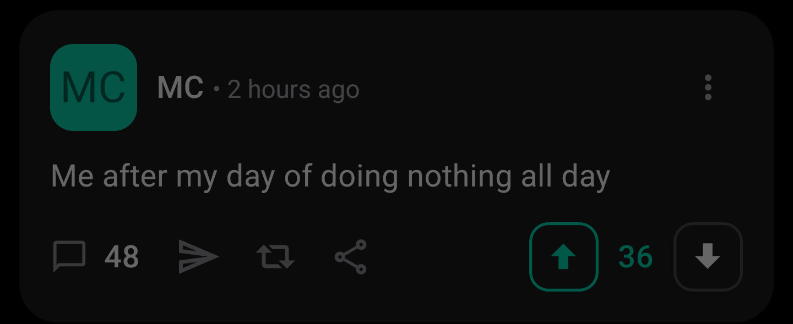
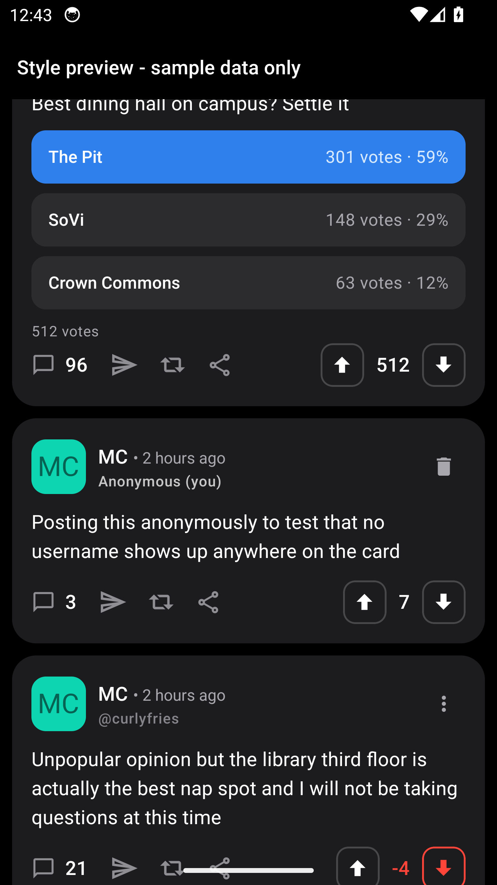

# Offsides+

An improved Android client for [Sidechat](https://sidechat.lol) / YikYak, forked from the (now deprecated) [Offsides](https://github.com/micahlt/offsides) by Micah Lindley and maintained by **Darek Anderson** ([@darek225](https://github.com/darek225)).

Upstream Offsides was deprecated in favor of the upcoming official YikYak Android app, and it shipped with real bugs: DMs silently stopped sending after the first message, posts and replies could vanish without any error, and anonymous mode leaked usernames. Offsides+ fixes those, wires up API features the original never used, and reskins the app to look like the current YikYak app.



## What Offsides+ fixes and adds

**Bug fixes (vs. upstream Offsides)**

- **DMs actually work.** Every DM was sent with the same `client_id` (a hash of the device ID); the server deduplicates on it, so only the first message in a thread ever landed. Each send now gets a fresh ID, matching the fix proven upstream in `micahlt/offsides#107`.
- **Failed posts/replies no longer vanish.** The server returns errors the old code treated as success; your draft now stays put and the app shows the server's actual message ("Server said: ...").
- **Anonymous means anonymous.** Anonymous mode defaults on with an explicit boolean (the old `undefined` state silently posted under your username), and posts never render a username when they were not posted with one.
- **No more frozen media.** Avatars, images, and videos in the feed no longer show the previous post's media when the list recycles cells.
- Correct 255 character limit, loading states that clear on failed fetches, DM threads in the right order with drafts kept on failure.

**Features the API had but the app never used**

- **Group chats**: browse, join (with your name or anonymously), and chat, with photo sending.
- **Poll results** with vote counts and percentages, viewable without voting; your pick is highlighted like the real app.
- **Hide posts from a user** (overflow menu on any post), plus **Unhide all users** in Settings.
- **Server-side group search** in Explore (the old search only filtered a small preloaded list).
- **Your library** in the composer: reuse images and memes you have already uploaded, like the Recents row in the real app's picker.
- **Share button** on posts.

**YikYak look (v1.2.0)**

- Fixed dark theme: black background, near-black rounded cards, white text, teal `#00DDB4` accent, square outline vote buttons that turn teal when upvoted and red when downvoted, blue selected poll option, teal chat bubbles for your messages.
- Update checks point at this repo's GitHub releases, so the in-app "Update Available" card gets Offsides+ builds instead of upstream's.

Full change log with evidence: [docs/IMPROVEMENTS.md](docs/IMPROVEMENTS.md).

## Screenshots

Style-preview captures from the CI emulator (sample data, no live account):

 

## Download

Grab the APK from the [latest release](https://github.com/darek225/offsides-improved/releases/latest) and install it manually (this is a reverse-engineered client, so it is not on the Play Store). Offsides+ installs side-by-side with the original Offsides under its own package name, `com.darekanderson.offsides`, so your old install is untouched. You will need to log in once on Offsides+.

Releases from v1.3.1 on are signed with the project's own Offsides+ key (earlier builds used a debug key, which is why installing 1.3.1 over an older build needs a one-time uninstall first). Android may still warn about the install source since this is not a Play Store app; the source is all here if you would rather build it yourself.

## Build from source

React Native / Expo SDK 54. You need Node 20+, Java 17, and the Android SDK (compile/target SDK 36).

```bash
npm ci          # postinstall applies patches/ to sidechat.js
cd android
./gradlew assembleRelease -PreactNativeArchitectures=arm64-v8a
```

The `patches/sidechat.js+2.6.6.patch` file (applied by patch-package) fixes three malformed API URLs in the upstream library (group explore, poll results, user content) and makes post/comment creation return server error bodies instead of swallowing them.

There is a dev-only style preview used to screenshot the design in CI without an account: build with `EXPO_PUBLIC_PREVIEW=1` and the app opens on a sample-data feed. Release builds never route to it.

## Known limitations

- **No DM push notifications on Android.** The server only pushes through Apple's APNs to the iOS app; there is no Android push channel to hook into. An opt-in polling notifier could be built but is not shipped.
- **Account actions are server-side.** If Sidechat has suspended your identity, no client can post around it; the app will at least show you the server's exact message. Appeals go to Sidechat support.
- No leave-group or DM-delete (no known API endpoints for either).

## Credits

- **Offsides+**: [Darek Anderson](https://github.com/darek225) - fixes, features, redesign, maintenance.
- **Offsides** (original app) and **sidechat.js** (API library): [Micah Lindley](https://github.com/micahlt). Thanks also to [SidechatProxy](https://github.com/OrenKohavi/SidechatProxy) by Oren Kohavi, instrumental to the original app's development.

## Disclaimer

Offsides+ is an unofficial third-party client. It is not affiliated with Sidechat, YikYak, or Flower Ave. Use it in line with their terms and your school's policies.

## License

Offsides+ is licensed under the GNU General Public License v3.0, the same license the original author added to Offsides (see [LICENSE](LICENSE)). The sidechat.js library is MIT-licensed upstream. This fork is published with the original author's permission and full attribution.
